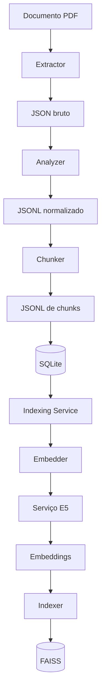
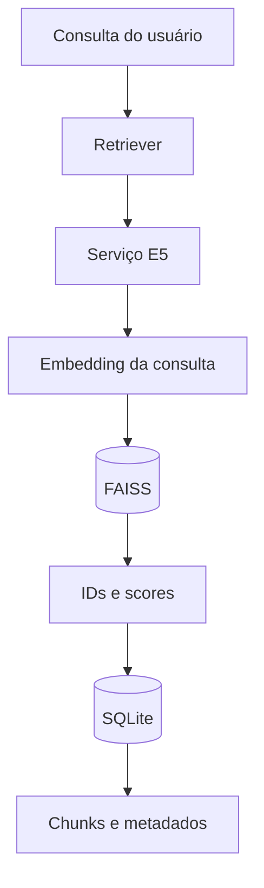

# Assistente de Documentos (DocsAssist)

---

O DocsAssist é um protótipo de sistema local voltado ao processamento, à organização, à indexação e à recuperação de informações em documentos. Seu objetivo é construir uma base documental pesquisável, permitindo localizar trechos relevantes a partir de consultas em linguagem natural, preservando informações sobre os documentos de origem.

O sistema utiliza uma pipeline modular que contempla extração de conteúdo de arquivos PDF, normalização de dados, segmentação textual (chunking), armazenamento em SQLite e geração de representações vetoriais (embeddings). A indexação semântica é realizada por meio do FAISS, enquanto o SQLite FTS5 disponibiliza mecanismos de busca textual baseados em BM25.

A arquitetura foi desenvolvida com foco em execução local, modularidade e utilização eficiente de recursos computacionais. As etapas de processamento podem ser executadas individualmente ou de forma integrada, contando com mecanismos de acompanhamento de progresso e persistência de metadados.

O projeto constitui a base para um sistema de Retrieval-Augmented Generation (RAG), no qual os documentos recuperados poderão fundamentar respostas geradas por modelos de linguagem. Atualmente, os mecanismos de recuperação lexical e semântica estão implementados, enquanto a integração com uma LLM, a recuperação híbrida e o refinamento inteligente de consultas fazem parte das próximas etapas de desenvolvimento.


---

## Arquitetura

A arquitetura do DocsAssist é organizada em módulos com responsabilidades específicas, permitindo que as etapas de processamento, armazenamento, indexação e recuperação sejam executadas de maneira independente ou integrada.

O sistema utiliza dois fluxos principais: **ingestão e indexação documental**, responsável por preparar e armazenar os documentos, e **recuperação de informações**, responsável por localizar trechos relevantes a partir das consultas realizadas pelo usuário.

### Processamento e indexação documental

A pipeline de ingestão transforma arquivos PDF em unidades textuais estruturadas, que são armazenadas no SQLite e posteriormente convertidas em representações vetoriais para recuperação semântica.



O `indexing_service.py` coordena a geração de embeddings e a atualização do índice vetorial. O serviço E5 permanece carregado em memória e disponibiliza operações de geração de embeddings e contagem de tokens por meio de requisições HTTP.

A indexação com FAISS é incremental, permitindo adicionar novos documentos ao índice existente. Quando um documento é reindexado, os vetores associados à sua versão anterior são removidos antes da inclusão dos novos.

### Recuperação de informações

A recuperação semântica utiliza o modelo `intfloat/multilingual-e5-small` para representar consultas em linguagem natural como vetores, possibilitando a comparação entre perguntas e trechos documentais, inclusive em diferentes idiomas.



O FAISS retorna os identificadores dos chunks mais similares à consulta e seus respectivos scores. Esses identificadores são utilizados para recuperar no SQLite o conteúdo textual e os metadados associados, incluindo documento, seção e páginas de origem.

Além da recuperação semântica, o SQLite disponibiliza busca textual por meio de FTS5 e BM25. Atualmente, os mecanismos de busca lexical e semântica estão implementados separadamente, sem fusão automática dos resultados.

### Persistência e acompanhamento

O SQLite atua como fonte principal de armazenamento dos documentos, chunks e seus metadados, enquanto o FAISS mantém o índice vetorial associado aos identificadores globais dos chunks.

O processamento também conta com manifestos individuais para registrar o estado das etapas, suas contagens e os identificadores associados à indexação. Um mecanismo independente de eventos de progresso permite acompanhar a execução pelo terminal, sem vincular os módulos de processamento à interface de apresentação.

A aplicação é executada em ambiente Docker, com um serviço independente para o modelo E5 e volumes destinados à persistência dos dados e artefatos gerados.

## Estrutura do projeto

O DocsAssist possui uma estrutura modular, organizada de acordo com as responsabilidades de processamento documental, persistência, indexação e recuperação de informações.

Os arquivos de código são separados dos documentos e dos artefatos gerados durante a execução, facilitando a manutenção, a expansão e o desenvolvimento independente dos componentes.

```text
DocsAssist/
├── src/
│   ├── main.py
│   ├── paths.py
│   ├── manifest.py
│   ├── progress.py
│   ├── extractor.py
│   ├── analyzer.py
│   ├── chunker.py
│   ├── embedder.py
│   ├── embedding_service.py
│   ├── indexer.py
│   ├── indexing_service.py
│   ├── manager.py
│   └── retriever.py
│
├── storage/
│   └── sqlite.py
│
├── tests/
│
├── docs/
├── raws/
├── normalizeds/
├── chunks/
├── manifests/
├── databases/
├── indexes/
│
├── Dockerfile
├── compose.yaml
├── requirements.txt
└── README.md
```

### Organização dos módulos

O diretório `src/` concentra os componentes responsáveis pela execução da pipeline e pelos mecanismos de recuperação.

- **`main.py`:** ponto de entrada da aplicação, responsável pela interface de linha de comando (CLI) e pela execução das etapas individuais ou da pipeline completa.
- **`paths.py`:**  centraliza a definição dos caminhos dos arquivos intermediários a partir do documento original.
- **`manifest.py`:** gerencia os manifestos de processamento, incluindo criação, leitura, persistência e atualização dos estados das etapas.
- **`progress.py`:** define os eventos e callbacks de progresso, além da apresentação de barras no terminal.
- **`extractor.py`:** realiza a extração estruturada de conteúdo dos documentos PDF.
- **`analyzer.py`:** normaliza e organiza o conteúdo extraído em blocos textuais.
- **`chunker.py`:** agrupa os blocos em chunks, respeitando as regras de segmentação e o limite de tokens.
- **`embedder.py`:** realiza a comunicação com o serviço E5 para contagem de tokens e geração de embeddings.
- **`embedding_service.py`:** disponibiliza o modelo E5 por meio de uma API HTTP persistente.
- **`indexer.py`:** gerencia a criação, atualização, leitura e persistência do índice FAISS.
- **`indexing_service.py`:** coordena a geração de embeddings e a atualização incremental do índice vetorial.
- **`manager.py`:** identifica PDFs novos ou alterados e coordena a ingestão completa, marcando o documento como indexado somente após a conclusão.
- **`retriever.py`:** executa consultas semânticas e recupera os chunks correspondentes no SQLite.

O diretório `storage/` contém a camada de persistência SQLite, responsável pelo gerenciamento de documentos, chunks, metadados e estruturas de busca textual.

### Diretórios de dados

Os arquivos utilizados e produzidos durante a execução são distribuídos conforme sua finalidade:

- **docs/:** documentos originais utilizados como entrada.
- **raws/:** arquivos JSON produzidos pela extração.
- **normalizeds/:** arquivos JSONL contendo os blocos normalizados.
- **chunks/:** arquivos JSONL contendo os segmentos textuais.
- **manifests/:** manifestos com informações sobre o processamento de cada documento.
- **databases/:** arquivos de persistência do SQLite.
- **indexes/:** índices vetoriais persistidos pelo FAISS.
- **tests/:** testes automatizados das funcionalidades implementadas.

Os diretórios de dados são utilizados como volumes no Docker Compose, permitindo preservar os arquivos entre execuções e recriações dos containers.

### Configuração do Ambiente

Na raiz do projeto, o `Dockerfile` define o ambiente de execução da aplicação, enquanto o `compose.yaml` configura os serviços, os volumes e a comunicação entre os containers.

O `requirements.txt` reúne as dependências Python utilizadas pelo projeto, e o `README.md` centraliza as informações sobre arquitetura, instalação, execução e desenvolvimento.

## Etapas da pipeline

### 1. Extração

O `extractor.py` é responsável por extrair o conteúdo dos documentos PDF e transformá-lo em uma representação estruturada para as etapas seguintes da pipeline.

Atualmente, essa operação utiliza a biblioteca `PyMuPDF4LLM`, baseada no `PyMuPDF`.

Durante a extração, são obtidas informações como:

- Identificação e organização das páginas;
- Extração de blocos de conteúdo textual;
- Identificação de linhas e segmentos de texto;
- Preservação das informações estruturais disponibilizadas pela biblioteca;
- Associação dos elementos às respectivas páginas de origem.

O resultado é armazenado em um arquivo JSON, preservando a estrutura extraída antes dos tratamentos realizados pela normalização.

O fluxo dessa etapa é:

```text
docs/arquivo.pdf --> extractor --> raws/arquivo-<hash>.json
``` 

O arquivo produzido contém os elementos extraídos e seus metadados estruturais, que serão utilizados pelo `analyzer.py` para a organização e normalização do conteúdo.

A extração também atualiza o manifesto com a quantidade de páginas processadas e o status da etapa. Quando o progresso está habilitado, são apresentados os estados inicial e final do processamento, sem acompanhamento individual de cada página.

### 2. Normalização

O `analyzer.py` é responsável por transformar o JSON bruto produzido pelo `extractor.py` em blocos de conteúdo normalizados e organizados.

Nessa etapa, são realizados tratamentos como:

- Identificação e organização de parágrafos;
- Agrupamento de itens consecutivos de listas;
- Preservação das seções e páginas de origem;
- Organização dos blocos na sequência do documento;
- Preservação de metadados relevantes para as etapas seguintes.

O resultado é armazenado no formato JSONL (*JSON Lines*), no qual cada linha representa um bloco independente.

O fluxo dessa etapa é:

```text
raws/arquivo-<hash>.json --> analyzer.py --> normalizeds/arquivo-<hash>.jsonl
```

Cada bloco normalizado contém informações como tipo, conteúdo textual, seção, página de origem e índice do parágrafo.

A normalização também atualiza o manifesto com a quantidade de blocos produzidos e o status da etapa. Quando o progresso está habilitado, o processamento é acompanhado por páginas.

### 3. Chunking

O `chunker.py` é responsável por segmentar os blocos normalizados em unidades textuais menores (chunks), adequadas para armazenamento, indexação e recuperação de informações.

A segmentação utiliza o tokenizer do modelo `intfloat/multilingual-e5-small` para calcular a quantidade de tokens dos blocos, adotando um limite de referência de 400 tokens por chunk.

A estratégia de segmentação considera os seguintes critérios:

- Preservação da integridade dos blocos textuais e das listas;
- Agrupamento de blocos consecutivos respeitando o limite de tokens;
- Separação dos chunks quando ocorre mudança de seção;
- Possibilidade de reunir conteúdos de páginas consecutivas;
- Desconsideração de blocos sem conteúdo textual.

A contagem de tokens é realizada por meio do serviço E5, utilizando requisições HTTP em lotes (batches) de até 64 blocos. Essa abordagem evita carregar o tokenizer diretamente no chunker e reduz a quantidade de requisições ao serviço.

O resultado é armazenado em formato JSONL, com um chunk por linha.

O fluxo dessa etapa é:

```text 
normalizeds/arquivo-<hash>.jsonl --> chunker.py --> Serviço E5 (/token-count) --> chunks/arquivo-<hash>.jsonl
```

Cada chunk preserva metadados como documento de origem, índice, seção, páginas inicial e final, quantidade de tokens e conteúdo textual.

A etapa também atualiza o manifesto com a quantidade de blocos processados e chunks produzidos. Quando habilitado, o progresso é apresentado conforme os blocos são processados.

Atualmente, blocos individuais que ultrapassam o limite de tokens ainda não são subdivididos automaticamente.

### 4. Persistência em SQLite

O módulo `storage/sqlite.py` é responsável pelo armazenamento e gerenciamento dos documentos, chunks e metadados produzidos durante o processamento.

A persistência utiliza o SQLite, organizado principalmente em duas tabelas: `documents`, que mantém as informações dos arquivos originais, e `chunks`, que armazena os segmentos textuais associados a cada documento.

Entre as funcionalidades implementadas estão:

- Cadastro de documentos e armazenamento de metadados;
- Identificação de arquivos por caminho e hash SHA-256;
- Armazenamento de chunks com suas seções e páginas de origem;
- Gerenciamento dos identificadores globais de documentos e chunks;
- Substituição dos chunks antigos quando um documento é reimportado;
- Recuperação textual por meio de SQLite FTS5 e BM25.

O fluxo de persistência é:

```text
chunks/arquivo-<hash>.jsonl --> storage/sqlite.py --> databases/rag.db
                                                       ├── documents
                                                       ├── chunks
                                                       └── chunks_fts
```

Cada `chunk` recebe um identificador global (`id`) e um índice local (`chunk_index`), que representa sua posição dentro do documento. O identificador global também é utilizado pelo FAISS para associar os vetores aos respectivos registros do SQLite.

A busca textual utiliza uma tabela virtual FTS5, mantida sincronizada com os `chunks` por meio de `triggers`. O algoritmo BM25 é utilizado para ordenar os resultados conforme sua relevância lexical.

Quando um documento é reimportado, seu identificador é preservado, enquanto os `chunks` anteriores são substituídos por novos registros. A atualização correspondente no índice vetorial é realizada posteriormente pela etapa de indexação.

### 5. Serviço E5

O `embedding_service.py` é responsável por disponibilizar o modelo `intfloat/multilingual-e5-small` como um serviço persistente, permitindo a geração de embeddings e a contagem de tokens por meio de requisições HTTP.

O serviço utiliza FastAPI e Sentence Transformers, mantendo o modelo carregado em memória durante sua execução. Essa abordagem evita o carregamento repetido do modelo pelas diferentes etapas da pipeline.

Atualmente, são disponibilizados dois endpoints:

- **POST /embed:** recebe uma lista de textos e retorna seus embeddings normalizados, com 384 dimensões.
- **POST /token-count:** recebe uma lista de textos e retorna a quantidade de tokens de cada elemento, utilizando o tokenizer do próprio modelo E5.

Ambos os endpoints permitem o processamento de múltiplos textos em uma única requisição, possibilitando sua utilização em lotes (batches).

O fluxo de comunicação é:

```text
DocsAssist
    │
    │ Requisição HTTP
    ▼
Serviço E5 (FastAPI)
    ├── POST /embed       → Embeddings
    └── POST /token-count → Contagem de tokens
```

O modelo E5 utiliza prefixos específicos para diferenciar os textos dos documentos (`passage:`) das consultas (`query:`), permitindo que suas representações sejam utilizadas na recuperação semântica.

O serviço é executado em um container independente, identificado como `embedder` no Docker Compose. Os demais módulos se comunicam com ele pela rede interna do Docker, sem precisar carregar localmente o modelo ou seu tokenizer.

### 6. Geração de embeddings

O `embedder.py` é responsável pela geração das representações vetoriais (embeddings) dos chunks armazenados no SQLite, utilizando o serviço E5 para transformar o conteúdo textual em vetores numéricos.
O módulo consulta os chunks associados ao documento original e encaminha seus textos ao endpoint `/embed`, utilizando o prefixo `passage:` exigido pelo modelo.

O processamento considera as seguintes operações:

- Recuperação dos chunks e seus identificadores globais no SQLite;
- Preparação dos textos com prefixo `passage:`;
- Envio dos textos em lote (batches) de até 64 chunks;
- Recebimento dos embeddings normalizados, com 384 dimensões;
- Preservação da associação entre cada embedding e seu respectivo `chunk_id`.

O fluxo dessa etapa é:
```text
SQLite --> embedder.py --> Batches de chunks --> Serviço E5 (/embed) --> Embeddings + chunk_ids --> Indexação FAISS
```

Os embeddings e seus identificadores são retornados ao serviço de indexação, responsável por encaminhá-los ao FAISS. Os vetores não são armazenados diretamente no SQLite.

O módulo também permite gerar embeddings de consultas utilizando o prefixo `query:`, que serão empregados posteriormente na recuperação semântica.

A geração de embeddings atualiza o manifesto com o status da etapa e a quantidade de vetores produzidos. Quando habilitado, o progresso é acompanhado conforme os lotes são processados.

### 7. Indexação FAISS

O `indexer.py` é responsável pelo gerenciamento do índice vetorial utilizado na recuperação semântica, enquanto o `indexing_service.py` coordena a geração de embeddings e a atualização dos vetores associados a cada documento.

A indexação utiliza a biblioteca FAISS (Facebook AI Similarity Search), empregando `IndexFlatIP` para comparação por produto interno e `IndexIDMap2` para associar os vetores aos identificadores globais dos chunks armazenados no SQLite.

Como os embeddings são normalizados, o produto interno permite ordenar os vetores de maneira equivalente à similaridade de cosseno.

O processo de indexação contempla as seguintes operações:

- Carregamento do índice FAISS existente ou criação de um novo;
- Recuperação dos identificadores anteriormente indexados a partir do manifesto;
- Remoção dos vetores antigos associados ao documento;
- Inclusão dos novos embeddings com seus respectivos `chunk_ids`;
- Persistência do índice atualizado para utilização em consultas posteriores.

O fluxo dessa etapa é:

```text
indexing_service.py --> Embeddings + chunk_ids --> indexer.py --> Carrega ou cria índice FAISS --> Remove vetores antigos --> Adiciona novos vetores --> indexes/docsassist.faiss
```

A indexação é incremental, permitindo que diferentes documentos compartilhem um único índice vetorial. Quando um documento é reprocessado, apenas seus vetores anteriores são substituídos, preservando os registros dos demais documentos.

O manifesto mantém os identificadores associados à última indexação do documento, possibilitando sua atualização mesmo quando as etapas de chunking e indexação são executadas separadamente.

Após a persistência bem-sucedida do índice, o manifesto é atualizado com os novos identificadores, a quantidade de vetores e o status da etapa. O progresso também pode ser acompanhado pelo terminal quando habilitado.

### 8. Recuperação de informações

O `retriever.py` é responsável pela recuperação semântica de trechos documentais a partir de consultas em linguagem natural, utilizando os embeddings gerados pelo modelo E5 e o índice vetorial FAISS.

O módulo transforma a consulta em uma representação vetorial utilizando o prefixo `query:` e realiza uma busca por similaridade entre esse vetor e os embeddings previamente indexados.

O processo de recuperação contempla as seguintes operações:

- Recebimento da consulta em linguagem natural;
- Geração do embedding da consulta por meio do serviço E5;
- Carregamento do índice FAISS persistido;
- Recuperação dos identificadores e scores dos chunks mais similares;
- Consulta ao SQLite para obtenção dos textos e metadados correspondentes;
- Organização dos resultados conforme a similaridade com a consulta.

O fluxo dessa etapa é:

```text
Consulta do usuário --> retriever.py --> Serviço E5 (/embed) --> Embedding da consulta --> FAISS (busca por similaridade) --> chunk_ids + scores --> SQLite --> Chunks e metadados
```

A quantidade de resultados recuperados é controlada pelo parâmetro `k`, que define o número máximo de chunks retornados. Quando esse valor ultrapassa a quantidade de vetores disponíveis no índice, a busca é limitada ao total existente.

Cada resultado contém o conteúdo textual recuperado, seu score de similaridade e informações sobre a origem, como documento, seção e páginas correspondentes.

Como os embeddings são normalizados, os scores produzidos pelo FAISS representam o produto interno, equivalente à similaridade de cosseno. Nesse mecanismo, valores maiores indicam maior similaridade. Já na função BM25 do SQLite FTS5, valores menores indicam resultados mais relevantes.

A utilização do modelo multilíngue permite realizar consultas em diferentes idiomas, mesmo quando o idioma da pergunta difere daquele utilizado nos documentos.

Atualmente, a recuperação semântica utiliza o FAISS para selecionar os candidatos. A busca lexical por FTS5/BM25 está disponivel separadamente, enquanto a combinação dos mecanismos e o refinamento dos resultados por modelos de linguagem estão previstos para as próximas etapas do projeto.

## Manifesto e acompanhamento de progresso

Os módulos `manifest.py` e `progress.py` são responsáveis pelo registro do estado de processamento dos documentos e pelo acompanhamento da execução das etapas da pipeline.

O `manifest.py` gerencia um arquivo `JSON` individual para cada documento, armazenado no diretório `manifests/`. Esse arquivo permite consultar o estado das etapas e preservar informações sobre os processamentos realizados.

A organização dos manifestos segue a estrutura:

```text
docs/arquivo.pdf --> manifests/arquivo-<hash>.json
                             ├── extraction
                             ├── normalization
                             ├── chunking
                             ├── embedding
                             └── indexing
```

O `progress.py` disponibiliza uma estrutura padronizada de eventos de progresso, utilizando `ProgressEvent` e callbacks para comunicar informações sobre a execução das etapas.

Quando a opção `--progress` é habilitada na interface de linha de comando, esses eventos são apresentados no terminal por meio de barras de progresso utilizando a biblioteca `tqdm`.

O acompanhamento é adaptado à implementação de cada etapa, podendo ocorrer por página, bloco ou lote processado.

Dessa forma, o manifesto mantém um registro persistente do processamento, enquanto os eventos de progresso oferecem acompanhamento durante a execução, sem interferir diretamente nas operações realizadas pela pipeline.

## Docker e Docker Compose

O DocsAssist utiliza Docker e Docker Compose para organizar o ambiente de execução e gerenciar os serviços necessários ao processamento e à recuperação de documentos.

A configuração é definida pelos arquivos `Dockerfile` e `compose.yaml`, permitindo executar a aplicação e o serviço de embeddings em containers separados.

A arquitetura é composta por dois serviços principais:

- **docsassist:** responsável pela execução da aplicação Python, incluindo extração, normalização, chunking, persistência, indexação e recuperação de informações.
- **embedder:** responsável pela execução persistente do modelo `intfloat/multilingual-e5-small`, disponibilizando os endpoints de embeddings e contagem de tokens por meio de FastAPI.

Os serviços se comunicam pela rede interna do Docker Compose, utilizando o endereço `http://embedder:8001` para acessar o serviço E5.

A organização do ambiente segue o fluxo:

 ```text
Docker Compose
    │
    ├── docsassist (Aplicação)
    │     ├── Pipeline de processamento
    │     ├── SQLite
    │     └── FAISS
    │
    └── embedder (FastAPI)
          ├── POST /embed
          └── POST /token-count

Comunicação interna:
docsassist ─── HTTP ───> embedder
 ```

O ambiente utiliza volumes para compartilhar os arquivos do projeto com os containers e preservar os dados produzidos durante a execução.

Entre os diretórios utilizados estão:

- `docs/`, `raws/`, `normalizeds/` e `chunks/`, destinados aos documentos e arquivos intermediários;
- `manifests/`, responsável pelos registros de processamento;
- `databases/`, destinado ao banco SQLite;
- `indexes/`, responsável pela persistência do índice FAISS.

Essa organização permite manter os arquivos gerados disponíveis no sistema hospedeiro, independentemente do ciclo de vida dos containers.

A separação dos serviços também evita o carregamento repetido do modelo E5 durante diferentes operações da pipeline, permitindo seu compartilhamento entre os módulos da aplicação.

## Execução da aplicação

O DocsAssist disponibiliza uma interface de linha de comando (CLI), implementada no `main.py`, que permite executar individualmente as etapas da pipeline ou realizar o processamento completo de um documento.

A aplicação pode ser executada por meio do Docker Compose, utilizando o serviço `docsassist`. As operações que dependem do modelo E5 iniciam automaticamente o serviço `embedder` e aguardam seu healthcheck antes de executar:

```bash
docker compose run --rm docsassist sync docs --progress
```

O primeiro início pode demorar enquanto o modelo E5 é carregado. O healthcheck confirma que a API FastAPI já está atendendo antes de liberar a execução do comando dependente.

### Processamento completo

O comando `all` executa de forma integrada as etapas de processamento, armazenamento e indexação de um documento PDF.

```bash
docker compose run --rm docsassist all docs/arquivo.pdf --progress
```

A opção `--progress` habilita as barras de progresso no terminal, permitindo acompanhar a execução das etapas.

### Manager incremental

O comando `sync` varre uma pasta recursivamente e processa apenas PDFs novos, alterados ou que não tenham concluído uma ingestão anterior. A comparação usa o hash SHA-256 e o status do documento no SQLite. Documentos já indexados e sem alterações são ignorados.

```bash
# Uma varredura
docker compose run --rm docsassist sync docs --progress

# Monitoramento contínuo; interrompa com Ctrl+C
docker compose run --rm docsassist sync docs --watch --interval 5 --progress
```

No modo de monitoramento, a pasta é verificada periodicamente, portanto novos arquivos são ingeridos sem precisar reprocessar os documentos existentes. Se uma etapa falhar, o documento fica com status `error`, a execução é reportada e a próxima varredura tenta processá-lo novamente. O hash aceito como versão processada só é atualizado depois que embeddings e indexação terminam. Os IDs dos chunks anteriores são preservados para que seus vetores sejam removidos do FAISS durante a reindexação.

Os arquivos intermediários e manifestos incluem um identificador derivado do caminho completo do documento. Assim, PDFs com o mesmo nome-base em subpastas diferentes não sobrescrevem seus artefatos.

### Execução individual das etapas

As operações também podem ser executadas separadamente, utilizando sempre o caminho do documento PDF original:

```bash
# Extração
docker compose run --rm docsassist extract docs/arquivo.pdf --progress

# Normalização
docker compose run --rm docsassist analyze docs/arquivo.pdf --progress

# Chunking
docker compose run --rm docsassist chunk docs/arquivo.pdf --progress

# Indexação
docker compose run --rm docsassist index docs/arquivo.pdf --progress
```

O argumento `doc_path` identifica o documento original, enquanto o módulo `paths.py` determina automaticamente os caminhos dos arquivos intermediários correspondentes.

Essa abordagem padroniza a execução dos comandos e permite repetir etapas específicas sem informar manualmente os caminhos dos arquivos gerados anteriormente.

### Recuperação de informações

A aplicação disponibiliza dois caminhos de busca:

- **search:** realiza consultas textuais utilizando SQLite FTS5 e BM25.
- **embed-search:** realiza consultas semânticas utilizando embeddings e o índice FAISS.

Exemplos de utilização:

```bash
# Busca textual
docker compose run --rm docsassist search "consumo de energia elétrica"

# Busca semântica
docker compose run --rm docsassist embed-search "Quais fatores influenciam o consumo de energia?"
```

Os resultados são apresentados no terminal, permitindo consultar os trechos recuperados e suas respectivas informações de origem.

Os comandos de processamento utilizam os diretórios configurados no projeto, enquanto os arquivos intermediários, o banco SQLite, os manifestos e o índice FAISS permanecem armazenados nos volumes compartilhados.

## Testes

O DocsAssist utiliza a biblioteca `unittest`, disponível na biblioteca padrão do Python, para realizar testes automatizados de seus componentes.

Os testes estão organizados no diretório `tests/` e têm como objetivo verificar o comportamento dos módulos, identificar possíveis regressões e auxiliar na validação das funcionalidades implementadas.

Os testes automatizados cobrem busca e persistência SQLite, além da seleção incremental de documentos, do isolamento de artefatos para nomes-base iguais e do tratamento de falhas durante a indexação.

Para executar os testes, utilize o ambiente virtual Python do projeto, com as dependências instaladas, e execute o seguinte comando na raiz do repositório:
```bash
python -m unittest discover -s tests -v
```

O comando identifica os arquivos de teste  no diretório `tests/`, executa os casos disponíveis e apresenta os resultados detalhados no terminal.

Além dos testes automatizados, o desenvolvimento também utiliza verificações manuais da pipeline, incluindo o processamento de documentos PDF, a geração de embeddings, a indexação no FAISS e a recuperação de trechos documentais.

A ampliação da cobertura de testes, especialmente para módulos de processamento, indexação e recuperação semântica, faz parte das próximas etapas de desenvolvimento.

## Limitações e próximas etapas

O DocsAssist encontra-se em desenvolvimento e atualmente oferece uma pipeline funcional para processamento, armazenamento, indexação e recuperação de informações em documentos PDF.

Embora os mecanismos de busca lexical e semântica estejam implementados, o projeto ainda apresenta limitações que serão abordadas nas próximas etapas.

Entre as principais limitações estão:

- Ausência de integração com um modelo de linguagem para geração de respostas;
- Execução independente das buscas lexical (BM25) e semântica (FAISS), sem mecanismo de recuperação híbrida;
- Ausência de refinamento automático das consultas e reordenação inteligente dos resultados;
- Falta de suporte específico para OCR em documentos digitalizados;
- Ausência de subdivisão automática de blocos individuais que ultrapassem o limite de tokens;
- O monitoramento de novos documentos precisa ser iniciado pelo comando `sync --watch`; não é um serviço autônomo em segundo plano.

As próximas etapas de desenvolvimento incluem:

- **Recuperação híbrida:** combinar os resultados de BM25 e FAISS, utilizando estratégias de fusão e reordenação;
- **Planejamento de consultas:** utilizar um modelo de linguagem para interpretar perguntas, identificar documentos relevantes e melhorar as estratégias de busca;
- **Geração de respostas:** integrar uma LLM para produzir respostas fundamentadas nos trechos recuperados, com referências aos documentos de origem;
- **Automatização da ingestão:** integrar o comando de monitoramento ao ciclo de vida da aplicação, se for necessário iniciá-lo automaticamente;
- **Ampliação dos testes:** desenvolver testes automatizados para os diferentes componentes da pipeline.

O objetivo é evoluir a arquitetura atual para um sistema RAG local capaz de consultar bases documentais e produzir respostas contextualizadas, mantendo a rastreabilidade das informações e o foco na utilização eficiente de recursos computacionais.
