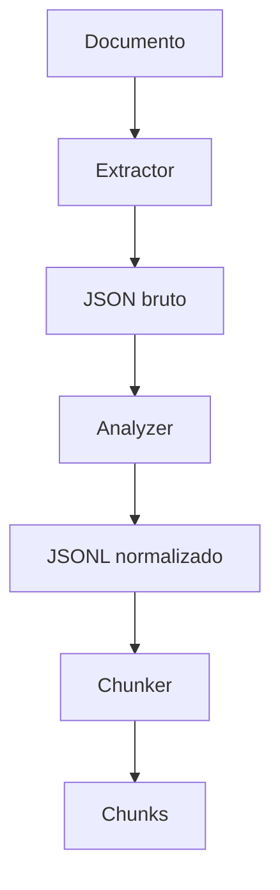

# Assistente de Documentos

--

A ideia é criar como protótipo um assitente que ajude na criação de documentos, buscando num base de documentos existente, e com bsae neles guiar e auxiliar a criar novos documentos.
A proposta é usar uma LLM local, junto com a técnica de Retrieval-Augmented Generation (RAG).

--

## 1ª Fase - Preparar o conjunto de dados internos

Nessa estapa é necessário preparar um banco de dados, com os arquivos que vão ser usados como fonte. Os textos são extraidos, depois são reduzidos em chunks, e depois é feito o embedding, onde ira classificar esses chunk a partir de um vetor. Então essas informações
serão armazenadas.

## 2ª Fase - Integrar com um modelo de LLM local

Nessa etepa com os dados já preparados, então é inserido um modelo de LLM local, que a partir de uma pergunta o sitema retorna documentos relevantes, com esses documentos já podemos passar isso para uma I.A. generativa, que pode analisar e auxiliar e tirar dúvidas na criação de documentos e como proseguir.

## SQLite

O projeto utiliza o SQLite como banco de dados local para armazenamento futuro dos documentos, chunks e metadados de recuperação

Nesta etapa, apenas o ambiente foi preparado. O banco de dados ainda não é criado automaticamente.

## Local RAG

Projeto experimental de RAG local para processamento e recuperação de documentos.

O objetivo atual é construir a pipeline de preparação de documentos antes da etapa de busca semântica e recuperação.

### Docker

O projeto pode ser executado através do Docker para garantir um ambiente consistente entre diferentes sistemas operacionais e máquinas.

A aplicação utiliza uma imagem Linux com Pyrhon e todas as dependências necessárias, evitando diferenças entre ambientes locais.

### Estrutura utilizada

```text
DocsAssist/
├── docs/
├── raws/
├── normalizeds/
├── chunks/
├── databases/
├── estrutura.txt
├── README.md
├── requirements.txt
└── src
    ├── extractor.py
    ├── analyzer.py
    ├── chunker.py
    └── main.py
```

As pastas de dados são montadas como volumes no container:

```text
Host                       Container

docs/          <------>     /app/docs
raws/          <------>     /app/raws
normalizeds/   <------>     /app/normalizeds
chunks/        <------>     /app/chunks
databases/     <------>     /app/databases
```

Dessas forma, os arquivos gerados permanecem disponíveis na maquina mesmo após o container ser encerrado.


### Requisitos

É necessário possuir: 
- Docker
- Docker Compose v2

Para verificar a instalação:
```bash
docker --version
docker compose version
```

### SQLite no container

O python já possui suporte natico ao SQLite através do módulo:

```python
import sqlite3
```

Além disso, o cliente da linha de comando do SQLite é instaldo na imagem Docker para facilitar testes e inspeção do banco.

Para verificar a versão disponível no container?

```bash
docker compose run --rm --entrypoint sqlite3 docsassist --version
```

Também é possível verificar o SQLite utilizado pelo Python:

```bash
docker compose run --rm --entrypoint python docsassist \
  -c "import sqlite3; print(sqlite3.sqlite_version)"
```

### Persistência

A pasta `databases/` é persistida através do `compose.yaml`.

Os arquivos de banco não são versionados no Git. Apenas a estrutura da pasta é mantida através de `.gitkeep`.

Exemplo:

```text
databases/
└── .gitkeep
```

No `.gitignore`

```gitignore
databases/*
!databases/.gitkeep
```

### Pipeline atual

O fluxo implementado até o momento é:



#### Extractor

O `extractor.py` é responsável por ler o documento original e extrair seu conteúdo.

Atualmente, PDFs são processados utilizando `pymupdf4llm`.

A saída é armazenada em formato JSON na pasta:

```text
raws/
```

#### Analyzer

O `analyzer.py` recebe o JSON bruto produzido pelo extractor e transforma o conteúdo em blocos normalizados.

Entre os tratamentos realizados estão:
* identificação e parágrafos;
* identificação de seções;
* agrupamento de itens consecutivos de listas;
* preservação da página de origem;
* manutenção da ordem dos blocos no documento.

A saída é armazenda em JSONL:

```text
normalizeds/
```

Cada linha representa um bloco normalizado independente.

Exemplo de estrutura:
```json
{
	"document": "arquivo.pdf",
	"page": 1,
	"section": "Introdução",
	"paragraph_index": 0,
	"type": "text",
	"text": "Conteúdo do parágrafo..."
}
```

#### Chunker

O `chunker.py` será responsável por agrupar os blocos normalizados em chunks adequados para recuperação semântica.

O tamanho dos chunks será controlado através da quantidade de tokens utilizando o tokenizer do modelo:

```text
intfloat/multilingual-e5-small
```
### Construindo a imagem

Na raiz do projeto:
```bash
docker compose build
```

A imagem contém:
- Python
- PyTorch CPU
- Transformers
- Sentence Transformers
- PyMuPDF4LLM
- demais dependências presentes em `requirements.txt`

O PyTorch utilizado é a versão destinada à CPU, não sendo necessária uma GPU dedicada.

### Verificando a aplicação

Para visualizar os comandos disponíveis:
```bash
docker compose run --rm docsassist --help
```

Os comandos disponíveis atualmente são:
```text
extract
analyze
chunk
all
```
#### Extração

Para processar apenas a extração de um documento:
```bash
docker compose rum --rm docsassist extract docs/arquivo.pdf
```

O resultado será salvo em:
```text
raws/
```

#### Normalização

Para normalizar apenas um arquivo previamente extraido:
```bash
docker compose rum --rm docsassist analyze raws/arquivo.json
```

O resultado será salvo em:
```text
normalizeds/
```

#### Geração de chunks

Para gerar os chunks a partir de um documento normalizado:
```bash
docker compose rum --rm docsassist chunk docs/arquivo.jsonl
```

O resultado será salvo em:
```text
chunks/
```

#### Pipeline completo

Para executar todas as etapas em sequência:
```bash
docker compose run --rm docsassist all docs/arquivo.pdf
```

### Próximas etapas

As próximas etapas previstas são:
* finalizar a geração de chunks;
* gerar embeddings com `sentece-transformers`;
* utilizar `intfloat/multilingual-e5-small`;
* indexar embeddings com FAISS;
* implementar busca lexical com SQLite FTS5/BM25;
* combinar busca lexical e semântica;
* adicionar processos automáticos de novos documentos.
