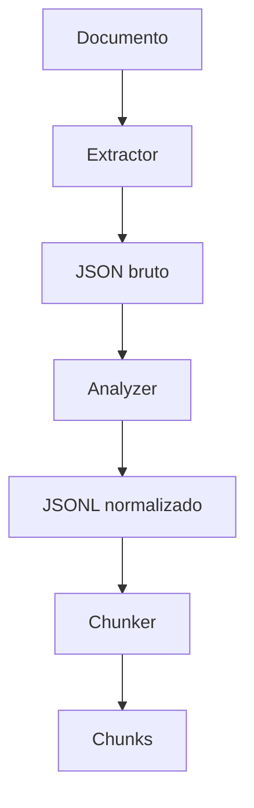

# Assistente de Documentos

--

A ideia é criar como protótipo um assitente que ajude na criação de documentos, buscando num base de documentos existente, e com bsae neles guiar e auxiliar a criar novos documentos.
A proposta é usar uma LLM local, junto com a técnica de Retrieval-Augmented Generation (RAG).

--

## 1ª Fase - Preparar o conjunto de dados internos

Nessa estapa é necessário preparar um banco de dados, com os arquivos que vão ser usados como fonte. Os textos são extraidos, depois são reduzidos em chunks, e depois é feito o embedding, onde ira classificar esses chunk a partir de um vetor. Então essas informações
serão armazenadas.

### Analisador dos documentos

### Requisitos

#### Banco de dados

## 2ª Fase - Integrar com um modelo de LLM local

Nessa etepa com os dados já preparados, então é inserido um modelo de LLM local, que a partir de uma pergunta o sitema retorna documentos relevantes, com esses documentos já podemos passar isso para uma I.A. generativa, que pode analisar e auxiliar e tirar dúvidas na criação de documentos e como proseguir.

## Local RAG

Projeto experimental de RAG local para processamento e recuperação de documentos.

O objetivo atual é construir a pipeline de preparação de documentos antes da etapa de busca semântica e recuperação.

### Pipeline atual

O fluxo implementado até o momento é:



#### Extractor

O `extractor.py` é responsável por ler o documento original e extrair seu conteúdo.

Atualmente, PDFs são processados utilizando `pymupdf4llm`.

A saída é armazenada em formato JSON na pasta:

```text
raws/
```

#### Analyzer

O `analyzer.py` recebe o JSON bruto produzido pelo extractor e transforma o conteúdo em blocos normalizados.

Entre os tratamentos realizados estão:
* identificação e parágrafos;
* identificação de seções;
* agrupamento de itens consecutivos de listas;
* preservação da página de origem;
* manutenção da ordem dos blocos no documento.

A saída é armazenda em JSONL:

```text
normalizeds/
```

Cada linha representa um bloco normalizado independente.

Exemplo de estrutura:
```json
{
	"document": "arquivo.pdf",
	"page": 1,
	"section": "Introdução",
	"paragraph_index": 0,
	"type": "text",
	"text": "Conteúdo do parágrafo..."
}
```

#### Chunker

O `chunker.py` será responsável por agrupar os blocos normalizados em chunks adequados para recuperação semântica.

O tamanho dos chunks será controlado através da quantidade de tokens utilizando o tokenizer do modelo:

```text
intfloat/multilingual-e5-small
```

### Estrutura atual

```text
DocsAssist/
├── docs/
├── raws/
├── normalizeds/
├── chunks/
├── estrutura.txt
├── README.md
├── requirements.txt
└── src
    ├── extractor.py
    ├── analyzer.py
    ├── chunker.py
    └── main.py
```

### Ambiente

Crie um ambiente virtual:
```bash
python3 -m venv .venv
source .venv/bin/activate
```

Instale as dependências:
```bash
python3 -m pip install -r requirements.txt
```

### Execução

O `main.py` permite executar etapas específicas da pipeline.

Extrair um documento:
```bash
python3 main.py extract docs/arquivo.pdf
```

Normalizar um JSON já extraido:
```bash
python3 main.py analyze raws/arquivo.json
```
Executar o chunker sobre um arquivo normalizado:
```bash
python3 main.py chunk normalizeds/arquivo.jsonl
```
Executar toda a pipeline:
```bash
python3 main.py all docs/arquivo.pdf
```

### Próximas etapas

As próximas etapas previstas são:
* finalizar a geração de chunks;
* gerar embeddings com `sentece-transformers`;
* utilizar `intfloat/multilingual-e5-small`;
* indexar embeddings com FAISS;
* implementar busca lexical com SQLite FTS5/BM25;
* combinar busca lexical e semântica;
* adicionar processos automáticos de novos documentos.
